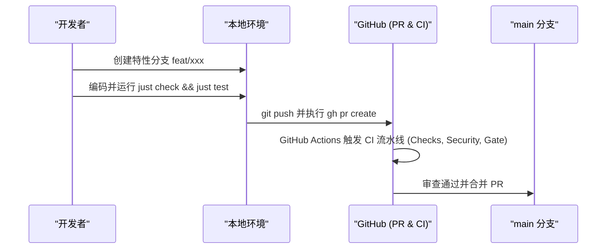

# 贡献指南

本项目为基于 OpenAI Codex 搜索后端的轻量 MCP 服务，遵循云端统一质量门禁与自动化流转。

## 一、开发环境准备

系统依赖以下标准工具链：

- [Bun](https://bun.sh)：TypeScript 运行时、依赖管理与测试驱动
- [just](https://github.com/casey/just)：统一命令调度器
- [Biome](https://biomejs.dev)：代码格式化与规范检查
- [GitHub CLI (gh)](https://cli.github.com)：PR 与远端协作操作

## 二、本地开发与质量门禁

日常开发遵循静态分析与测试约束，提交代码前必须确保门禁全绿：

```bash
# 格式化代码
just fmt

# 静态类型检查与规范校验
just check

# 执行测试套件
just test
```

## 三、协作与 PR 流程

项目严格采用 PR 模式协作，禁止直接向 `main` 分支推送业务代码：



1. 基于 `main` 分支拉取最新代码并创建特性分支；
2. 完成功能开发与本地验证，确保 `just check` 与 `just test` 全部通过；
3. 推送分支并通过 `gh pr create` 发起 Pull Request；
4. 等待 GitHub Actions 合并门禁验证通过后合入主干。
