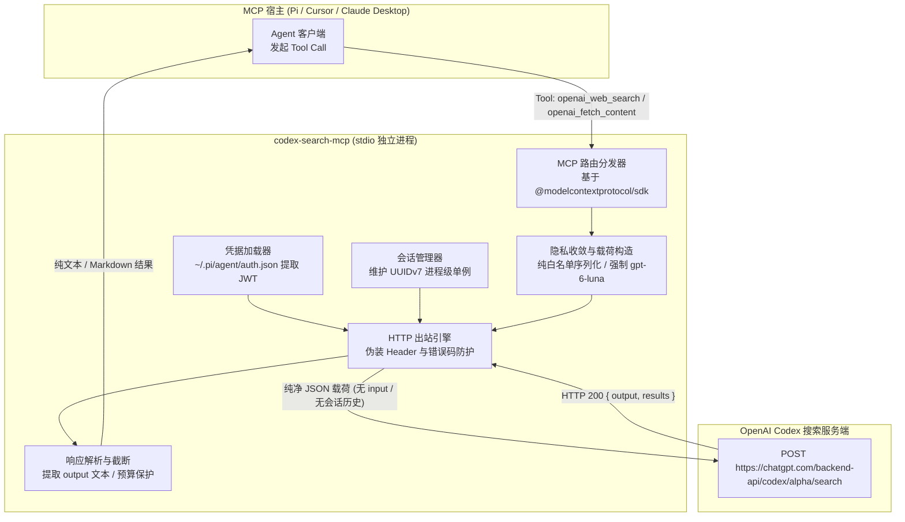

# codex-search-mcp 开发规范与需求说明书

---

## 1. 项目定位与目标

`codex-search-mcp` 是一个基于 OpenAI Codex 内部后端（`alpha/search`）实现的独立轻量 MCP (Model Context Protocol) 服务。其核心目标是替代复合插件（如 `pi-web-access`）中的网页搜索与页面阅读抓取能力，供任意支持 MCP 协议的宿主（如 Pi、Cursor、Claude Desktop）通用调用。

### 核心设计红线
1. **零上下文外泄**：严格采用请求载荷白名单机制，彻底禁止包含 `input`、`reasoning`、`instructions`、`turn_state` 等任何会话历史或思维链字段。OpenAI 端点仅能接收纯净的单个查询词或目标 URL。
2. **抗风控指纹精准对齐**：
   * **会话绑定与 UUIDv7**：对齐官方 Codex 客户端机制，会话 ID 采用 **UUIDv7** 生成并在会话生命周期内单例复用，严禁单次请求随机生成。
   * **官方模型混淆**：默认使用官方模型标识 `gpt-6-luna`。宿主传入非 OpenAI 竞品模型标识（如 `claude-*`、`gemini-*`、`deepseek-*`）时，强制清洗回退为 `gpt-6-luna`，杜绝异常账号审计。
   * **官方标识伪装**：客户端来源标识固定为官方第一方常量 `originator: codex_cli_rs`，携带桌面 Chromium 浏览器指纹，防止命中 Cloudflare 403 质询。

---

## 2. 权威协议与参考代码库

开发时必须直接对齐以下三个代码库的权威定义与成熟实践：

1. **官方 Codex 协议基准（权威协议源）**
   * **本地路径**：`/Users/sony/githubs/codex`
   * **核心模块与文件**：
     * `codex-rs/codex-api/src/search.rs`：`SearchRequest`、`SearchCommands`、`SearchQuery`、`OpenOperation` 结构体精确定义。
     * `codex-rs/codex-api/src/endpoint/search.rs`：搜索端点相对路径 `alpha/search`、Header 注入方式与响应结构 `SearchResponse`。
     * `codex-rs/ext/web-search/src/tool.rs`：`WebSearchTool` 命令组装与参数解析。
     * `codex-rs/ext/web-search/src/extension.rs`：`session_id` 生命周期绑定（基于 `session_store.level_id()`）。
     * `codex-rs/protocol/src/session_id.rs` 与 `thread_id.rs`：明确定义标识符必须为 **UUIDv7**。
     * `codex-rs/login/src/auth/default_client.rs`：官方常量 `DEFAULT_ORIGINATOR = "codex_cli_rs"`。

2. **社区参考实现（扩展封装参考）**
   * **本地路径**：`/Users/sony/githubs/pi-openai-web-search`
   * **核心模块与文件**：
     * `src/backend.ts`：JWT 解析、Cloudflare 伪装头构造、端点 URL 拼接。
     * `src/searchCommands.ts`：搜索与页面指令规范。
     * *需重构避坑点*：原实现中透传宿主模型名与收集历史上下文 `recentSearchInput` 的逻辑必须彻底剔除。

3. **现有集成参考（对比参考）**
   * **本地路径**：`/Users/sony/githubs/pi-web-access`
   * **核心模块与文件**：`openai-search.ts` 中的 `runOpenAISearch`、`buildAlphaSearchHeaders` 与 `parseAlphaSearchResponse`。

---

## 3. 架构与交互流



---

## 4. 详细技术规范与协议契约

### 4.1 网络请求与目标端点

* **目标 URL**：`https://chatgpt.com/backend-api/codex/alpha/search`
* **端点规则**：若上游 Provider 配置的 base 为 `https://chatgpt.com/backend-api`（不含 `/codex`），必须显式补齐 `/codex/alpha/search`。若拼错为 `/alpha/search` 会触发 Cloudflare 403 页面拦截。
* **HTTP 方法**：`POST`
* **Content-Type**：`application/json`
* **Accept**：`application/json`

### 4.2 本地凭证加载机制

MCP 服务以独立进程运行，按以下优先级获取 ChatGPT OAuth 凭据：
1. **文件源（优先）**：读取 `~/.pi/agent/auth.json`，解析 JSON 获取 `openai-codex.access` 或对应 token 字段。
2. **环境变量源（回退）**：支持读取 `OPENAI_ACCESS_TOKEN` 或 `CHATGPT_ACCESS_TOKEN`。
3. **Account ID 提取**：
   * 对 Access Token（JWT）执行解码，提取 payload 字段：`payload["https://api.openai.com/auth"]?.chatgpt_account_id`。
   * 若提取成功，必须在请求头中注入 `chatgpt-account-id`。

### 4.3 请求头构造规范（指纹防护）

出站请求必须严格携带以下 Headers，大小写与取值必须完全一致：

| Header 名称 | 取值规范 | 说明 |
| :--- | :--- | :--- |
| `Authorization` | `Bearer <access_token>` | 有效的 OAuth Access Token |
| `chatgpt-account-id` | `<account_id>` | 从 JWT 中解码获取，保持强关联 |
| `Session_id` | `<session_id>` | **注意大小写（Session_id）**。必须为 **UUIDv7** 格式，并在当前 MCP 运行生命周期内复用 |
| `originator` | `codex_cli_rs` | 官方 Codex 客户端第一方常量 |
| `x-client-request-id` | `<uuid>` | 单次请求追踪 UUID |
| `User-Agent` | `Mozilla/5.0 (Macintosh; Intel Mac OS X 10_15_7) AppleWebKit/537.36 (KHTML, like Gecko) Chrome/126.0.0.0 Safari/537.36` | 现代桌面浏览器指纹 |
| `sec-ch-ua` | `"Chromium";v="126", "Not.A/Brand";v="24"` | Client Hints 浏览器特征 |
| `sec-ch-ua-mobile` | `?0` | 桌面端标示 |
| `sec-ch-ua-platform` | `"macOS"` | 平台特征 |
| `accept-language` | `en-US,en;q=0.9` | 语言偏好 |

### 4.4 请求体规范（白名单与零泄露）

向 OpenAI 发送的请求体必须使用严格的白名单模式序列化，**禁止透传未知字段**：

```typescript
interface SearchRequestBody {
  id: string;               // 与 Header 中的 Session_id 一致的 UUIDv7
  model: string;            // 固定为 "gpt-6-luna" (支持环境变量 DEFAULT_SEARCH_MODEL 覆盖)
  commands: SearchCommands; // 检索或网页抓取指令
  max_output_tokens: number;// 输出 token 预算 (默认 15000)
}
```

#### 指令（`commands`）形状：
1. **网络检索模式**：
   ```json
   {
     "search_query": [
       {
         "q": "检索关键词或自然语言提问",
         "recency": 30,
         "domains": ["github.com"]
       }
     ],
     "response_length": "short"
   }
   ```
2. **网页阅读/正文抓取模式**：
   ```json
   {
     "open": [
       {
         "ref_id": "https://example.com/docs",
         "lineno": 1
       }
     ]
   }
   ```

---

## 5. 对外暴露的 MCP Tools

通过 `@modelcontextprotocol/sdk` 对外注册以下两个核心工具：

### 5.1 `openai_web_search`
* **描述**：通过 OpenAI 官方联网搜索服务检索互联网最新信息，返回高质量综述文本与参考来源。
* **参数 (Zod Schema)**：
  * `query` (string, 必需)：用户搜索词或完整问题。
  * `recency_days` (number, 可选)：最近天数过滤（如 1、7、30、365）。
  * `domains` (string[], 可选)：限定搜索的域名白名单列表。
  * `session_id` (string, 可选)：显式传入的会话标识（若缺省则自动使用当前会话单例 UUIDv7）。

### 5.2 `openai_fetch_content`
* **描述**：通过 OpenAI 内部正文抓取引擎阅读并提取指定 URL 的纯净页面内容（相当于内置 Readability 网页解析）。
* **参数 (Zod Schema)**：
  * `url` (string, 必需)：待抓取的完整 HTTP/HTTPS 网页地址。
  * `session_id` (string, 可选)：会话标识。

---

## 6. 响应处理与防护机制

1. **响应文本提取**：
   * 服务端响应结构为 `{ output: string, results?: Array<any> }`。
   * 优先提取 `output` 纯文本作为主结果返回给 MCP 客户端。
   * 若包含结构化 `results`（包含标题与 URL），可按需以清晰列表形式追加在文末。
2. **输出保护（Output Clamp）**：
   * 设置最大文本截断阈值（默认 60,000 字符）。
   * 超过阈值时，保留前 40,000 字符与后 15,000 字符，中间插入 `\n\n... [Content clamped for token budget] ...\n\n`。
3. **状态码映射友好提示**：
   * `401 Unauthorized`：提示凭证过期或未登录，引导在 Pi 中执行 `/login` 或检查 token。
   * `403 Forbidden`：明确提示可能命中 Cloudflare 质询拦截，需检查端点路径是否补齐 `/codex/`。
   * `429 Too Many Requests`：明确提示触发速率限制，建议降频调用。

---

## 7. 工程约束与交付清单

1. **运行时与工具链**：
   * 运行时：Bun
   * 规范与格式化：Biome（提交前必须通过 `just check`）
   * 任务调度：统一遵循项目根目录 `Justfile`（`just ci`、`just test`、`just build`）
2. **推荐项目目录组织**：
   ```text
   src/
   ├── auth/          # 本地凭据读取 (~/.pi/agent/auth.json) 与 JWT 账户解析
   ├── client/        # HTTP 请求封装、伪装头构造、UUIDv7 Session 管理
   ├── protocol/      # Request/Response 类型声明与白名单载荷组装
   ├── tools/         # MCP Tool 注册 (web_search / fetch_content)
   └── index.ts       # MCP Server stdio 入口
   tests/
   ├── auth.test.ts   # JWT 解析与凭据加载单测
   ├── payload.test.ts# 白名单序列化单测 (验证 input 绝对未声明)
   └── tools.test.ts  # MCP 工具注册与调用集成测试
   ```
3. **验收标准**：
   * 单元测试覆盖请求体序列化：确保生成的 JSON 字符串**绝对不包含 `input` 键**。
   * 单元测试覆盖模型标识清洗：确保外部传入任何第三方模型名均被替换为 `gpt-6-luna`。
   * 全流程通过 `just ci`，所有 GitHub Actions 门禁（跨平台矩阵测试、CodeQL、密钥扫描、Gate）100% 全绿。
